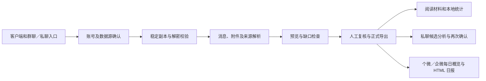

# 维护与构建

所有命令从仓库根目录执行。环境安装和四类启动参数见 [仓库首页](../README.md)。

## 解析与复核流程



`DesktopSession` 连接两种客户端读取器和共用导出流程。群聊与私聊通过 `conversation_mode` 分开选择、恢复和复核。画像的来源、候选、确认版本与基线摘要沿用原有合同；本轮没有迁移旧库。

两个日报入口共用 `offline_daily.py` 和 `offline_daily_html.py`，读取正式导出，不增加数据库读取或密钥提取路径；`offline_daily_ui.py` 提供后台生成与取消、材料和日期选择、业务预览及文件打开入口，复用原助手的主题与日历。`DAILY_REPORT_VERSION` 独立维护日报版本；1.3.0 通过 `build_daily_reports.ps1` 单独构建两个标准库单文件、每个客户端的桌面与命令行 EXE、两个便携包和两个 Skill。原四类包的构建矩阵不变。业务区域只显示概览、跟进及原文，技术追踪保存在 `diagnostics.jsonl`。输入、构建和验证见 [日报脚本说明](daily-reports.md)。

## 更新版本

修改 `WeBridge/scripts/chat_release.py` 的版本，然后执行：

```powershell
.\.venv\Scripts\python.exe WeBridge\scripts\sync_chat_release.py
.\.venv\Scripts\python.exe WeBridge\scripts\sync_chat_release.py --check
```

同步只更新三个维护中的 Skill 模板元数据。两个群聊包由一个模板按客户端生成，两个私聊模板分别绑定客户端。运行时版本直接导入公共模块；历史修复文档保留原版本，不批量改写历史。

## 必要检查

```powershell
.\.venv\Scripts\python.exe WeBridge\scripts\check_runtime_identity.py
.\.venv\Scripts\python.exe WeBridge\scripts\check_assistants.py --report .runtime\validation.json
git diff --check
```

检查器仅运行维护中的定向检查及其合成夹具，输出用例数、失败项和未验证范围。原生 Tk 和 Windows 文件句柄检查需要带桌面的 Windows 环境；若启动 Tk 就失败，应先检查 Python 的 Tcl/Tk 安装和资源读取权限，不能据此修改业务结果或把错误当作通过。

可在命令末尾指定单个 unittest 名称缩小复验范围。修复本次引起的失败后复验受影响部分，不为文案修改重跑全部检查。

## 构建四类运行包

```powershell
uv pip install --python .venv\Scripts\python.exe -r WeBridge\scripts\requirements-offline-build.txt
& .\WeBridge\scripts\build_all_chat.ps1 -Python "$PWD\.venv\Scripts\python.exe"
```

构建先生成一个同时支持群聊和私聊的桌面 EXE，以及画像 CLI，再打包。已有目录会被拒绝，需选择 `WeBridge/build/` 下的新目录，或确认旧产物不再需要后自行处理。

已有本次构建的 EXE 时可单独打包；两个路径必须显式指定：

```powershell
.\.venv\Scripts\python.exe WeBridge\scripts\package_four_chat.py `
  --desktop-exe WeBridge\build\v71\bin\local-chat-desktop.exe `
  --profile-cli-exe WeBridge\build\v71\bin\private-chat-profile.exe `
  --output-root WeBridge\build\v71\packages
```

`packages/` 包含两个群聊 Skill ZIP、`private/` 下两个私聊 Skill ZIP、共用 `desktop.zip` 和 `release-matrix.json`。不要把整个 `packages/` 当作 Skill 导入；分别选择对应客户端和会话类型的独立包。打包器不会根据目录时间自动选择历史 EXE。

能力查询只证明二进制自报的版本和接口，摘要只证明文件一致性。发布新版运行包前仍应对新 EXE 做启动、四类合成解析及宿主导入检查，并在具备真实材料时复验原故障会话。

## 公开源码范围

导入范围由 [原始文件摘要](imported-source.json) 记录，本轮改动见 Git 差异。原始开发仓库存在其他未提交工作，因此直接复制所需源码，没有提交、重置或清理原仓库。

公开内容限于相关源码、文档、许可证文本和虚构测试。账号设置、密钥、数据库、媒体、快照、画像、历史诊断包和构建产物不提交。原指南中的历史私聊分享入口已移除；最终 Git 暂存区还需检查文件范围与敏感内容。
